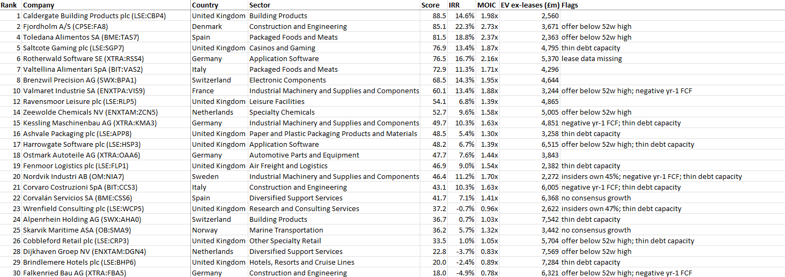

# LBO Target Screener

This is a python tool used to screen UK and European listed companies for take-private LBO potential. It takes a Capital IQ screen export, removes companies outside the mandate (for a specific project), runs a simplified five-year LBO on every company remaining, and scores them on returns and other metrics. The results are fed into a ranked excel report.

## What the screener does

1. **Import and clean:** reads the Capital IQ export first, then maps the full column headers into shorter names before converting text to numbers and fixig data quirks (eg; sign conventions, blanks converted to '-', unrealistic values adjusted).
2. **Exclude:** remove companies outside of the mandate (in this case, non-European listings, Enterprise Value outside £1-10bn, missing financials or loss-making firms). Record and list the reason for each exclusion.
3. **Metrics:** use the information from Capital IQ to produce lease-adjusted net debt and Enterprise Value (EV), EV/EBITDA against the sector median, cash conversion, initial leverage, margin stability (measured with a standard deviation of past returns) and forecasted growth.
4. **Mini-LBO:** the key of the project! A five-year cash-sweep LBO on each company: entry at a premium to market value, debt sized against EBITDA, all free cash flow used to repay debt, and exit at the entry multiple. The outputs produced are IRR, MOIC, the equity cheque at takeover, and exit leverage.
5. **Score and flag:** combines five measures into a 0-100 score and adds flags for issues the scores will not necessarily reflect, such as enterprise value being outside of the target range (even though within the confines of the mandate).
6. **Report:** writes an Excel file with the top 25 in the target size range, the top 25 overal, the full ranking, every exclusion (and the reason), and the assumptions used.

## Decisions made

- **Lease adjustment:** Capital IQ's LTM EBITDA is after rent but net debt and EV include IFRS 16 lease liabilities. Using both means leases would be counted twice and means lease-heavy businesses (eg; hotels, retail, etc.) appear to be more expensive and levered than they are. This is adjusted for by removing leases from net debt and EV, so all measures are on the same post-rent basis.
- **Growth on a consistent basis:** Consensus EBITA forecasts are usually stated before rent, while Capital IQ's LTM EBITDA is after it, so comparing forecasts with LTM will overstate growth. Growth is taken from consensus FY+1 and FY+2 only. I capped growth rates applied at -2% to 10% year as consensus is often optimistic. Fallback where consensus data is not available are the 3-year revenue CAGR, then a 3% default.
- **Percentile scoring:** The five measures are on completely different scales so each are converted into a percentile rank before being weighted. Missing data is scored at the median so it neither helps nor harms that company's score. Since the data is from 0-1, this median value is 0.5
- **Flags:** Issues that require judgement on an individual company basis (such as the given offer price being below the 52week high, controlling shareholder(s), existing leverage, negative free cash flow, etc.) are flagged for manual review rather than immediately excluding the company.

## Scoring method

| Measure | Weight | Better when |
| --- | --- | --- |
| Mini-LBO IRR | 45% | Higher |
| Equity cheque as a % of total cost | 15% | Lower |
| EBITDA margin volatility (5 years) | 15% | Lower |
| Cash conversion: (EBITDA - capex) | EBITDA | 15% | Higher |
| Year 1 free cash flow / debt | 10% | Higher

## Output using sample data

Top of the £2-8bn sheet from the included, **fictional** sample data. Rank is the overall rank, so companies outside the £2-8bn range are skipped.



## How to run

Requires Python 3.11 or newer.

```
pip install -r requriements.txt
python lbo_screener.py sample_data/sample_export.xlsx
```

All results are saved to `output/sample_export_results.xlsx`.
To run on your own Capital IQ export, save it in the same layout and pass its path instead.

Assumptions and weights are set at the top of `lbo_screener.py`.

## Assumptions used

| Setting | Value |
| --- | --- |
| Offer premium | 35% over current share price |
| Fees | 2.5% of entry EV |
| Debt | Lower of 5.0x EBITDA and 60% of total cost |
| Interest rate | 8% (placeholder) |
| Tax | 25% |
| Holding period | 5 years, 100% cash sweep |
| Exit | At the entry EV/EBITDA multiple |

## LIMITATIONS

This is purely a screening tool, and not a valuation model. The screener ignores working capital, pension deficits, minority interests and one-off items. The model also treats capex as a proxy for depreciation in the tax charge. Margins and capex are held at today's levels. Interest is a placeholder rate rather than market pricing for each credit. Shortlisted companies need a full model and due diligence.

## Data

`sample_data/sample_export.xlsx` contains fictional companies and figures, laid out like a Capital IQ export. This is purely for demonstration. 

## Project structure

```
lbo_screener.py      the screener
requirements.txt     Python dependencies
sample_data/         fictional example input
docs/                images for this README
```

Built by Samuel Keane